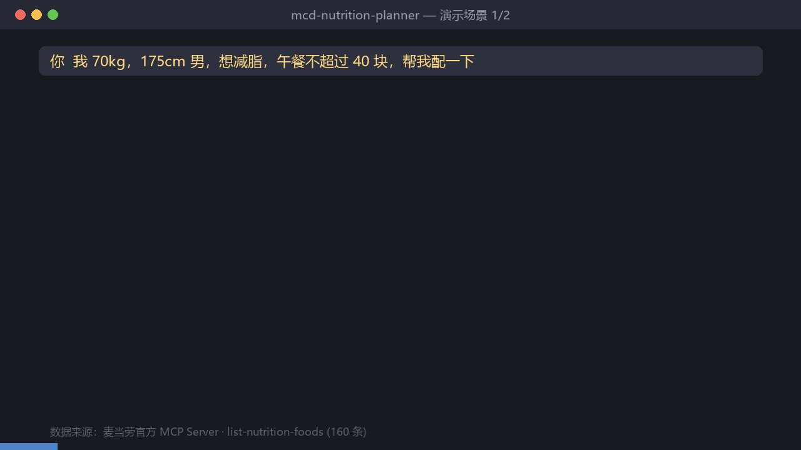

<div align="center">

# 麦门营养配餐官

### Mcd Nutrition Planner

**把「今天吃点什么」变成一道有解的数学题**

基于麦当劳官方 MCP 实时数据 · 热量 / 蛋白质 / 预算三目标配餐优化

[](https://www.python.org/)
[]()
[]()

</div>

---

## 一、它解决什么问题

在麦当劳点餐时的真实痛点，从来不是「不知道买什么」，而是 **「知道买什么，但不知道买哪个对自己更好」**：

- 减脂期想吃汉堡 → 不知道哪个热量负担小、蛋白够不够
- 增肌期想补蛋白 → 不知道哪些餐品蛋白密度更高
- 午餐预算 40 块 → 想在预算内把营养配得更优
- 忌口（辣 / 牛肉 / 海鲜）→ 不知道菜单里还剩什么可选

官方 MCP 提供了 **160 条结构化营养数据**， 但普通用户很难据此做决策。本项目把它变成 **可执行的三目标优化**。

> 官方 README 举的例子是「身材管控期也想吃麦当劳」。这个场景，就是本项目的起点。

---

## 二、演示

<div align="center">



**↑ 实时运行录屏：控卡减脂场景 与 增肌补充场景**

</div>

注意增肌场景最后一行：**蛋白只达成 87%**。本项目不会假装推荐完美，而是明确告诉你差距在哪、为什么差。

这正是与「罗列一堆餐品让你自己选」的根本区别。

---

## 三、这个项目适合谁

| 你是 | 可以用它在|
|---|---|
| 在减脂 / 增肌期，但不想自己算 | 说人话就能拿到配餐方案 + 达标率 |
| 做 MCP / Agent 开发 | 完整可复用的四层响应解包 + toon 解析实现 |
| 麦当劳 MCP 重度用户 | 30 个工具的踩坑记录，避坑 |

**这些工具对所有麦当劳 MCP 用户通用**，不只是配餐场景 —— `unwrap_mcp_text()` 和 `parse_toon_table()` 可以直接拿去解析任何该MCP Server 的返回。

如果你觉得这个项目省了你时间，**点个 Star ⭐ 是最好的鼓励**。
这个项目正在参加麦当劳程序员创意开发大赛，排名完全按 GitHub Star 总数，
10/25 截止 —— 你的 Star 会直接影响它能不能进前 100。

---

## 四、快速开始

### 前置条件

- Python 3.9+
- 麦当劳 MCP Token（[申请地址](https://open.mcd.cn/mcp)，登录 → 控制台 → 激活）

### 1. 设置 Token

```bash
export MCD_MCP_TOKEN="你的TOKEN"        # macOS / Linux
set MCD_MCP_TOKEN=你的TOKEN             # Windows CMD
$env:MCD_MCP_TOKEN="你的TOKEN"          # PowerShell
```

> Token 只从环境变量读取，代码中无任何硬编码。请勿提交到版本库。

### 2. 验证连接

```bash
python scripts/mcp_client.py tools
```

预期输出 `可用工具 35 个`。

### 3. 运行离线自检（无需网络）

```bash
python scripts/nutrition_engine.py
```

验证解析器与优化引擎的正确性，输出示例方案。

### 4. 在 Agent 中使用

**WorkBuddy / Cursor / Cherry Studio 等客户端**：

配置 MCP 连接器后直接对话即可。

```json
{
  "mcpServers": {
    "mcd-mcp": {
      "type": "streamablehttp",
      "url": "https://mcp.mcd.cn",
      "headers": { "Authorization": "Bearer ${MCD_MCP_TOKEN}" }
    }
  }
}
```

**命令行直接查询**：

```bash
python scripts/mcp_client.py nutrition        # 全量营养数据摘要
python scripts/mcp_client.py stores 苏州      # 查询附近门店
python scripts/mcp_client.py meals <storeCode># 门店实时菜单
python scripts/mcp_client.py coupons          # 可领优惠券
python scripts/mcp_client.py account          # 积分余额
python scripts/mcp_client.py campaign         # 活动日历
```

### 5. 说人话就行

```
我 70kg，175cm 男，想减脂，午餐不超过 40 块，帮我配
增肌期想吃麦当劳补蛋白，有什么高蛋白的
不吃牛肉，推荐午餐
```

---

## 五、核心差异：为什么不只是"查询转发"

市面上已有的麦当劳推荐类项目，大多停留在**信息罗列**或**单维度排序**。本项目的差异在三点：

### 1. 三目标量化寻优，而非单一排序

热量、蛋白质、预算三个目标加权寻优，并输出 **达标率** 让用户判断差距。

### 2. 处理了 MCP 返回的两层非标准格式

这是本项目最主要的工程价值。麦当劳 MCP 的返回**不是纯 JSON**， 而是四层嵌套：

```
Markdown 字段说明（含 {序号} 占位符）
  ↓ "## Original Response" 分隔符
JSON 字符串
  ↓ obj["data"] 仍是字符串
toon 紧凑格式表格 ← 160 条记录
  ↓ 按列名 + 行记录
结构化营养数据
```

**两个真实踩坑点**：

| 坑 | 现象 | 解法 |
|---|---|---|
| 占位符干扰JSON 提取 | 说明文字里有 `{序号}`，粗暴取首个花括号会拿到错误片段 | 括号配对 + 转义感知扫描，取能 `loads` 成功的最长片段 |
| 字段内含逗号 | toon 行直接 `split(',')` 会错列 | 逗号数匹配则直切，否则从右向左按列数反向定位分隔符 |

实测 **160 / 160 条 100% 解析成功**。

### 3. 阈值用真实数据标定，而非照抄教科书

这是最容易被忽略、也最有价值的一点：

| 版本 | 钠惩罚基准 | 命中率 | 诊断 |
|:---:|---:|---:|---|
| v1 | 800 mg | ~18% | 恰等于 P75，区分度不足 |
| v2 | 1400 mg | **0%** | **全表最大仅 1373 mg，惩罚项静默失效** |
| v3 | **600 mg** | ~25% |最终采纳 |

官方数据钠分布：最小 1 ｜ P25 80 ｜ 中位 147 ｜ P75 705 ｜ 最大 1373 mg。

**v2 的失败值得记录**：1400 mg 看起来更"科学"，但完全脱离真实分布。这类 bug 不抛异常、不崩溃，只让优化目标**静默地不起作用** ——必须用真实数据回归验证。

完整分析见 [`references/nutrition-data.md`](references/nutrition-data.md)。

### 4. 加权评分存在结构性套利，已修正

做演示动图时发现，算法在增肌场景输出了这样的方案：

```
· 双层深海鳕鱼堡  485 kcal  蛋白 28.0 g  ¥22.0
· 麦乐鸡5块       213 kcal  蛋白 12.0 g  ¥11.0
· 麦辣鸡翅         224 kcal  蛋白 13.0 g  ¥13.0
· 冰美式小杯        15 kcal  蛋白  0.0 g  ¥10.0   ← 占预算却几乎无营养
· 圆筒冰淇淋93 kcal  蛋白  2.0 g  ¥6.0
```

**这不是搜索 bug，而是目标函数的设计盲区**：冰淇淋热量低会拉低总热量让热量项得分虚高，同时便宜又让预算项受益。单独看每项都不算离谱，叠加后「低热量 + 便宜」的零食就成了最优解。

修正方式是补充 **与目标正交** 的结构性约束：

```python
# 蛋白能量占比惩罚：低于 55% 标准参考时计罚
if protein_share < 0.55:
    bonus -= (0.55 - protein_share) * 45.0
# 低热量密度单品（饮料/冰品）占比超过 28% 时计罚
if snack_ratio > 0.28:
    bonus -= (snack_ratio - 0.28) * 90.0
```

修正后控卡场景结果**完全不变**（747 kcal / 蛋白 38 g），说明新约束没有破坏原有合理方案——这正是回归测试应有的效果。

> 教训：加权归一化要防结构性套利，光调权重不够，必须加正交约束项。这类问题在**可视化呈现时才会暴露**，只看数字输出不容易发现。

### 5. 技术文章

三篇踩坑记录，可直接发布到掘金 / 知乎 / CSDN：

| 文章 | 主打角度 |
|---|---|
| [`blog/01-阈值静默失效.md`](blog/01-阈值静默失效.md) | 一段永远返回 0 的函数如何静默废掉整个功能（最容易引发共鸣） |
| [`blog/02-MCP踩坑实录.md`](blog/02-MCP踩坑实录.md) | 35 vs 24 工具差异、四层响应解包、toon 解析 |
| [`blog/03-三个技术坑.md`](blog/03-三个技术坑.md) | 精简版，适合社区问答 / 短贴分发 |

---

## 六、算法

### 评分函数

```
score = 0.42 × 热量得分
      + 0.36 × 蛋白得分
      + 0.22 × 预算得分
      + 偏好加分 / 忌口扣分 / 钠惩罚 / 可售加权
```

| 分项 | 规则 |
|---|---|
| 热量 | 低于预算按偏离比例扣分；**超出预算惩罚更陡**（宁可略低不要爆） |
| 蛋白 | 低于目标线性扣分；高于目标少量加分（鼓励但不过度） |
| 预算 | 不超支满分，超支重扣；允许略低于预算以换取更高营养密度 |

采用**加权归一化而非硬约束**——好处是不会出现"无解"：即使所有组合都超预算，也总能给出相对最优解并明确告知差距。

### 热量预算模型

```
BMR  = Mifflin-St Jeor 公式
TDEE = BMR × 活动系数（1.2 / 1.375 / 1.55 / 1.725 / 1.9）
单餐预算 = TDEE × 目标系数 × 餐次系数（早 0.30 / 午 0.40 / 晚 0.30）
蛋白目标 = 体重 × 目标系数（减脂 1.8 / 维持 1.2 / 增肌 2.2 g/kg）
```

### 搜索空间控制

组合结构为 `1 主餐 + 0~2 小食 + 0~1 饮料 + 0~1 甜品`。为避免组合爆炸：

1. 主餐按单品得分预筛，仅 Top 14 进入组合搜索
2. 小食 Top 10、饮料 Top 6、甜品 Top 5
3. 剪枝：热量低于目标 30% 或高于 155% 的组合直接丢弃
4. 按菜品名组合去重

---

## 七、目标用户

| 用户 | 场景 |
|---|---|
| 减脂健身人群 | 控卡期点餐，需要量化决策而非凭感觉 |
| 增肌训练人群 | 知道 160 个餐品里只有 15 个高蛋白选项，需要系统筛选 |
| 上班族 | 工作日午餐预算固定，想在限额内配得更优 |
| 特殊饮食需求者 | 忌口 / 过敏，需快速筛出可选项 |
| 麦当劳 MCP 开发者 | 可直接复用解析层与优化引擎作为二次开发起点 |

---

## 八、项目结构

```
mcd-triple-target/
├── SKILL.md                      # Skill 主文件（Agent 直接读取）
├── README.md                     # 本文件
├── CONTEST_DECLARATION.md        # 参赛声明（内容固定）
├── MCP_INTEGRATION.md            # MCP 集成说明与调用流程
├── mcp-config.example.json       # 脱敏配置示例
├── workbuddy.md                  # WorkBuddy 对话上下文
├── assets/
│   └── demo.gif                  # 演示动图（内容来自真实算法输出）
├── blog/
│   ├── 01-阈值静默失效.md         # 技术文章：静默失效踩坑
│   ├── 02-MCP踩坑实录.md          # 技术文章：协议解析踩坑
│   └── 03-三个技术坑.md           # 技术文章：精简版
├── scripts/
│   ├── nutrition_engine.py       # 解包 + toon 解析 + 优化引擎（可离线自检）
│   └── mcp_client.py             # MCP 客户端与命令行入口
├── tools/
│   ├── make_demo.py              # 演示动图生成（数据来自真实算法）
│   └── publish.sh                # 一键发布：建仓 + 推送 + 回填地址
└── references/
    └── nutrition-data.md         # 营养数据分布分析与阈值标定记录
```

**零第三方依赖**：核心脚本仅用 Python 标准库（`json`、`urllib`、`re`、`dataclasses`），可直接在任何环境运行。动图生成脚本 `tools/make_demo.py` 额外需要 `pillow`，仅用于生成素材，不影响核心功能。

---

## 九、快速发布

```bash
bash tools/publish.sh 你的GitHub用户名
```

脚本自动完成：Token 安全扫描 → 离线自检 → 回填 workbuddy.md 仓库地址 → 提交 → 创建 Public 仓库 → 推送 → 输出报名 Issue 模板。

---

## 十、实测记录

开发过程中的真实 MCP 调用结果：

| 验证项 | 结果 |
|---|---|
| MCP 连接 | 成功，协议版本 2025-06-18 |
| 可用工具 | 35 个（官方 README 列出 24 个） |
| 营养数据解析 | 160 / 160 条，100% 成功 |
| 参数 schema 校验 | 9 个核心工具入参全部实测确认 |
| 积分账户读取 | 成功（`query-my-account`） |
| 优惠券读取 | 成功（`available-coupons`） |
| 离线自检 | 通过（`nutrition_engine.py`） |

---

## 十一、已知限制

- 营养表按单品给出，套餐需通过 `query-meal-detail` 展开后重新核算
- 价格与可售状态因门店、时段而异，方案需以门店实际供应为准
- `nutritionDescription` 字段实测几乎全为 `null`，本项目未使用
- `create-order` 下单链路已就绪但默认不自动执行，需用户明确确认

---

## 十二、致谢

感谢金拱门（中国）有限公司开放 MCP Server 与本次创意开发大赛，让开发者能在真实业务场景上做真实的东西。

本项目为独立开发者作品，**非麦当劳官方产品**。所有数据来自麦当劳官方 MCP Server，版权归麦当劳所有。输出建议仅供参考，不构成医疗、营养或其他专业建议；餐品信息、价格及供应状态以官方渠道实时结果为准。如有健康状况或特殊饮食需求，请咨询医生或注册营养师。

---

<div align="center">
<sub>MIT License ｜ Made withMCP</sub>
</div>